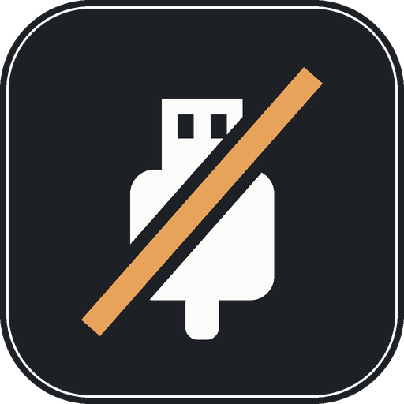

 

  
  <h3 align="center">Unplug</h3>
  
Block USB devices so no application can use them.

## Table of Contents

- [About The Project](#about-the-project)
  - [Built With](#built-with)
- [Getting Started](#getting-started)
  - [Prerequisites](#prerequisites)
  - [Installation](#installation)
- [Usage](#usage)
- [Credits](#credits)

## About The Project

**Unplug** is for the joystick that keeps moving the game when nobody touches it. Some games read every controller they find, and the only
way out is to pull the cable. Unplug lists your USB devices and turns the ones you pick off at the driver level (what Device Manager calls
*Disable device*), so no application can read them. Unblock a device and it is back, without touching the cable.

Unplug is an **unofficial**, independent tool. It shares its look, build and release system with the [Cairn launcher](https://github.com/Cairn-client/Launcher).

### Built With

*  with [egui](https://github.com/emilk/egui) for the window

## Getting Started

### Prerequisites

* Windows 10 or 11

### Installation

Download the latest `Unplug-X.Y.Z.exe` from the [Releases](https://github.com/cmpnn-romain/Unplug/releases) page and run it. There is nothing to install.

The program is not code-signed yet, so Windows may warn: click **More info**, then **Run anyway**. It asks for administrator rights, because
turning a device off needs them.

## Usage

Each device has a switch: green is on (the device works), red is off (blocked, no application can read it). **Unblock all** puts every device back.

- Devices are in categories (Controllers, Keyboards, Mice, Storage, Audio, Cameras, Other), found from what each device says about itself.
- Everything can be done from the keyboard, for when the mouse is one of the devices: **Left** and **Right** choose the category, **Up** and
  **Down** the device, **Space** switches it, **Ctrl+U** unblocks all, **Esc** hides the window.
- Unplug stays in the notification area when you close the window. Click its icon to open the window; right-click it for **Unblock all**,
  **Check for updates** and **Exit**.
- A keyboard or a mouse cannot be blocked from here, so the tool cannot lock you out. A device that is not a controller asks before it is blocked.
- Unplug looks for a newer release when it starts and offers to install it; it checks the download against the checksum GitHub lists for it.
- A blocked device stays blocked after you close Unplug and after a restart, until you unblock it. Without this tool, open Device Manager,
  find the device and choose *Enable device*.
- `unplug --demo` runs the window on a made-up list that changes in memory only.

## Credits

See [AUTHORS.md](AUTHORS.md) for the complete list of contributors and the lineage.

## License

Unplug is free software under the [GNU General Public License v3.0](LICENSE).

(<a href="#readme-top">back to top</a>)

